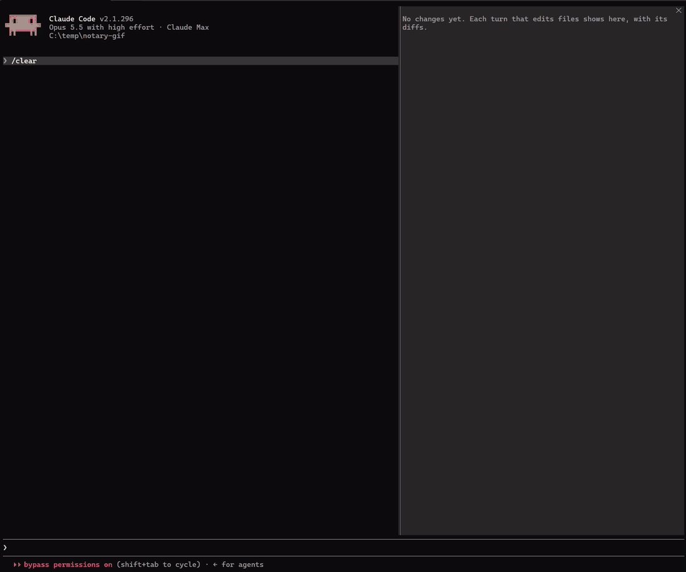

# Notary

**Changes: see what Claude changed, turn by turn. Keep it or send it back.**



<sub>Not staged: the prompts are ordinary requests. One file from an earlier turn is reverted, and Claude is told.</sub>

Changes is a [Claude Code mod](https://code.claude.com/docs/en/plugins/mods/overview). It keeps a timeline of what Claude changed in each turn of your session, including through subagents, with each file's diff and a **Revert** that puts the file back the way it was before that turn.

Notary is a suite of small mods that check Claude's work for you. **Changes** shows you what changed and lets you undo it. **Receipts** checks Claude's "all tests pass" against what it actually ran.

## Install

At the prompt of a Claude Code session in a terminal (Claude Code 2.1.287 or later):

```
/plugin install changes --marketplace candygoogy/notary
/plugin install receipts --marketplace candygoogy/notary
```

Each mod installs on its own; take one or both. Answer `y` to add the marketplace, then pick a scope (user scope makes it load in every session). A mod is active right away. Once installed at user scope, it also runs in the Claude desktop app's Code tab.

From your shell instead (Claude Code 2.1.292 or later): `claude plugin install changes --marketplace candygoogy/notary`. If it says options are "not yet set", that's fine: every option has a default, so there's nothing to set up.

### Update and remove

Claude Code doesn't auto-update plugins from marketplaces like this one unless you turn it on. To get a new version, run `/plugin`, open the **Marketplaces** tab, select **notary**, and choose **Update marketplace**. That tab also has **Enable auto-update**.

To remove a mod, open it on the **Installed** tab in `/plugin` and choose **Uninstall**, or run `claude plugin uninstall changes@notary` in your shell.

## Changes

`/changes` opens the **Changes** pane. In the fullscreen layout it docks beside the transcript.

- A **timeline** of the session, newest turn first. Each turn lists its steps: the tool calls that changed files, and the subagents it started, with their own calls.
- **Each file's diff**, including the contents of new files, with **Keep** and **Revert**.

After a turn that changed code, a line above the prompt says `Turn #12 changed 3 files  [Open] [Dismiss]`. Turns that only touched docs, notes or lockfiles don't show it, but the pane still lists them.

### Keep and Revert

**Keep** marks a file as reviewed and folds it away. Nothing on disk changes.

**Revert** puts the file back the way it was before that turn. It takes two presses: the first checks the file and writes nothing, and the second, **Confirm revert (#12)**, writes it.

- It only writes when the file on disk is exactly what Claude left, and it reads the file back afterwards to make sure.
- When it can't be sure, it refuses and says why. If you changed the file yourself after Claude's edit, it leaves the file alone. If a later turn also changed it, it offers **Revert with #14**, so the two turns go back together.
- Claude gets a short hidden note about the revert, so it re-reads the file instead of editing from memory.

### How it differs from `/diff`

The built-in `/diff` shows the working tree's git diff. Changes works per turn and can undo:

- it has **Revert**, with the checks above;
- it shows the contents of **new files**, not just their names;
- it sees **subagent edits**, under the turn that started the subagent;
- it works outside git too. Only tracking shell commands needs git.

### Limits

- **History is kept for 7 days.** A new session and `/clear` start an empty pane. Resume a conversation within 7 days of last using it (`keepHistoryDays`) and its earlier turns come back. After that its history is deleted (sooner if all kept history passes 1 GB), and those turns can't be reverted from the pane. Your files are untouched.
- **Per file, not per hunk.** Revert puts the whole file back.
- **Shell commands only in git.** Files changed by Bash or PowerShell commands are seen only inside a git repository, and not when gitignored.
- **No merging.** If the file changed after Claude's edit, Revert refuses rather than guess.

Settings, the full list of refusals and the remaining limits are in [plugins/changes/README.md](plugins/changes/README.md).

## Receipts

**Claude says the tests pass. Receipts checks.**

When Claude ends a turn saying the work is done, fixed or passing, Receipts looks at what Claude actually ran since its last edit. If the tests failed, it says so, and by default it sends Claude back once to fix it.

### What you'll see

Receipts judges a turn when Claude's final answer claims success and code has changed since the last passing check. It is quiet by default: it speaks up only when a claim is about tests or a build and the evidence says otherwise.

| Verdict | When | What you see by default |
|---|---|---|
| ❌ **Contradicted** | The latest check after the last edit failed, and nothing passed after it. | A band above the prompt and a stamp under the answer, and Claude is sent back once to fix it. `🧾 ❌ Contradicted: "All tests pass." · npm test exited 1 (1 failed)` |
| ⚠️ **Unverified** | A claim about tests or the build, after code edits in this turn, with no check since (or only one still running, or one that found no tests). | Band and stamp, and a reminder goes to Claude with your next prompt. The band goes once Claude has answered it. `🧾 ⚠️ Unverified: no receipts · no check ran after the last edit` |
| ✅ **Verified** | The latest check after the last edit passed. | For answers about tests or the build: a stamp, and the band until your next prompt. `🧾 ✅ Verified · npm test passed (42)` |

A check that failed and then passed counts as ✅.

Everything else goes only to the `/receipts` pane. That covers general claims ("Done.", "Fixed.") whether ✅ or ⚠️, and ⚠️ about edits from earlier turns. The pane lists every judged turn: the verdict, the claim, the command that decided it and its key output line. To see every verdict on the band and in a stamp, set **verbosity** to `all`.

Edits that can't break a test don't reopen verification. Tests pass, then Claude updates a doc, a progress note, a memory file or `CLAUDE.md`, and says "All tests pass": that's still ✅. The same goes for scratch and temp files, build output, and files outside the project.

### What happens next: modes

| Mode | ⚠️ Unverified | ❌ Contradicted |
|---|---|---|
| **A**: warn | band and stamp | band and stamp |
| **B**: warn and nudge (default) | band and stamp, plus a reminder attached to your next prompt | band and stamp, plus Claude is **sent back once** to fix it |
| **C**: enforce | Claude is sent back once | Claude is sent back once |

The mode acts on the verdicts that are shown. With the default verbosity, a ⚠️ that only goes to the pane never sends a reminder or sends Claude back.

"Sent back" means Claude keeps working, with Receipts' reason in front of it. It happens at most once per turn, so it can't loop. Here is a staged demo (the prompt asked Claude to claim success after a failing test, so we could record it):

> **Claude:** Fixed. All tests pass.
>
> **Receipts:** you claimed "All tests pass.", but npm test exited 1 (1 failed). Fix it and verify before claiming success.
>
> **Claude:** My earlier "Fixed. All tests pass." was false. The first `npm test` run failed, and the hook caught it. The bug was in `add.js`: `add` returned `a - b`, so `add(2, 3)` gave `-1` instead of `5`. I changed it to `a + b`. Rerunning `npm test` now exits 0 with 1 test passing, 0 failing.

Outright false claims like that are rare. The everyday cases are quieter: tests that passed *before* the last edit, a test run left in the background, a failure hidden because the output was piped through `tail`, or "done" with no check at all. Those are what Receipts is for.

### How it decides

1. **Claims.** Receipts reads Claude's final answer sentence by sentence, looking for success claims: "Fixed", "All tests pass", "The build succeeds", "No type errors", "Ready to merge". It skips sentences that hedge ("should work"), disclaim ("I haven't run the tests"), negate, ask, or set a condition. It ignores code blocks, inline code, quotes and unchecked to-do items.
2. **Edits.** Every `Edit`, `Write` and `NotebookEdit` to code in the project that landed, by Claude or a subagent.
3. **Checks.** Every Bash and PowerShell command Claude ran, sorted by what it proves:
   - Test runners (npm/pnpm/yarn/bun test, vitest, jest, pytest, cargo test, go test, dotnet test, Invoke-Pester and more) back any claim.
   - Builds, type checks, linters and localhost health checks back build claims ("the build passes", "no type errors") and general claims like "fixed", but not "the tests pass".
   - Formatting checks (`prettier --check`, `ruff format --check`, `cargo fmt --check` and the like) prove nothing either way, so an unformatted file never contradicts "fixed".
   - Neither do commands like `git status`, `--version`, or anything ending in `|| true`.
4. **Verdict.** For each claim, the latest qualifying check after the last edit decides. A claim about tests needs a test run.

It goes by the runner's exit code. When a pipe hides it, the runner's own summary decides ("1 failed", `test result: FAILED`). The full rules and the list of recognized tools are in [plugins/receipts/README.md](plugins/receipts/README.md).

### Numbers

Before each release, we replay real Claude Code sessions through Receipts (`npm run replay`). It runs locally and prints only counts. As of 2026-10-13, on one developer's 105 sessions (2,784 turns, 562 of them ending in a success claim), with the default settings Receipts would have:

- shown **5 flags**, all ⚠️, about one every 110 claim turns;
- raised **no ❌** and sent Claude back **zero times**;
- attached **5 reminders**;
- stamped **118** test or build claims ✅;
- kept **45** more ⚠️ in the pane, mostly general claims like "Done.".

The honest finding: in those sessions, Claude never claimed success against a check that had just failed. The real catches were stale checks, a few times in 105 sessions. For example, "the tests pass" after a later CSS or code edit. Receipts is cheap insurance for those, and it stays out of the way the rest of the time.

Getting there took work. Earlier versions flagged 355 turns on the same sessions, 16 of them ❌. Every ❌ was checked by hand, every one turned out to be Receipts' own mistake, and each became a test sample.

### Settings

Change them in the `/config` menu, or with the command:

| Setting | Command | Default |
|---|---|---|
| Mode | `/receipts mode A`, `B` or `C` | B |
| On or off | `/receipts off`, `/receipts on` | on |
| Smart check (see Privacy) | `/receipts smart on`, `/receipts smart off` | off |
| Verbosity: `quiet` or `all` | `/receipts verbosity quiet`, `/receipts verbosity all` | quiet |
| Stamp line under answers | `/config` | on |

### Limits

- **English only.** v1 recognizes claims written in English. A Turkish "testler geçiyor" is not judged.
- **It checks that checks ran, not what they cover.** A passing test suite that doesn't test your change still counts as ✅.
- **Background runs.** A test started in the background with no result yet is not evidence, so the claim is ⚠️ until it finishes.
- **Edits made through the shell** (`sed -i`, `Set-Content`, a script) are not counted as edits, so they don't reopen verification.
  - A "break it on purpose, run one test, put it back" check is fine: a failing run of part of the suite after a full pass of the same runner doesn't overturn that pass.
  - The flip side: if such a script breaks the code and *doesn't* put it back, Receipts still shows the earlier ✅.
- **A revert from the Changes pane isn't an edit to Receipts.** A ✅ given before the revert stands until Claude edits again.
- **Subagents' own reports** aren't judged. Their edits and test runs do count toward the main conversation's claims.
- **Long, mixed sentences** ("Fixed the parser, but the timezone case is left") are skipped unless smart check is on.

## Privacy

Both mods run entirely on your machine. They make no network requests, collect no telemetry, and make no model calls. Nothing they keep leaves your machine.

Changes keeps a copy of each file Claude changed, and the conversation's history of those changes, in `~/.claude/plugin-data/notary-changes/`. It keeps them for 7 days after you last used the conversation, so a resumed conversation can still revert, and holds all of them under 1 GB. The copies can include secrets, such as a `.env` file Claude edited. `/changes forget` deletes the current conversation's copies now, and setting `keepHistoryDays` to `0` deletes them at the end of every session.

The one exception is Receipts' **smart check**, which is off unless you turn it on. Then, for a sentence the phrase rules can't settle, Receipts asks a small model whether it claims success. Only that sentence is sent, through your own Claude Code session, and it counts toward your usage.

## The Notary suite

| Mod | What it does | Status |
|---|---|---|
| **Changes** | A per-turn timeline of what Claude changed, with a diff and Keep/Revert per file | v0.2 |
| **Receipts** | Flags success claims no check backs up | v0.2 |
| **Scope Cop** | Blocks edits outside the scope you declared | planned |

## Contributing

The most useful bug reports are exact:
- **Changes:** a revert that wrote the wrong bytes, or a refusal whose reason didn't make sense. Include the pane's note and what the file looked like before and after.
- **Receipts:** a missed or wrong verdict. Include the band or stamp text, the sentence and the command output: each one becomes a test sample.

See [CONTRIBUTING.md](CONTRIBUTING.md) for setup and tests.

## License

[MIT](LICENSE)
